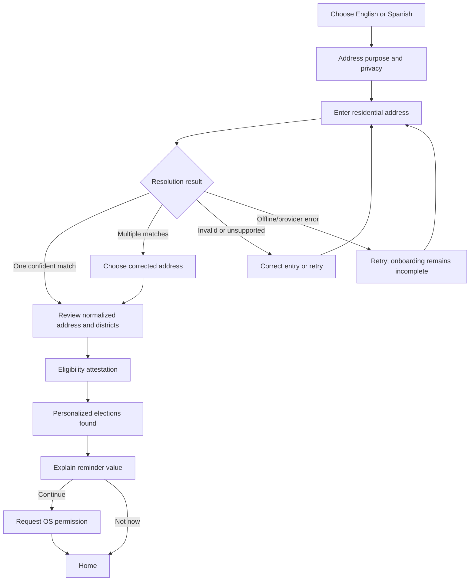
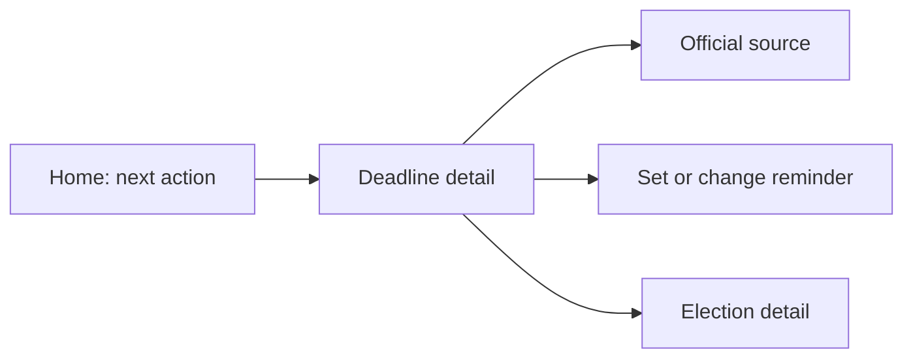
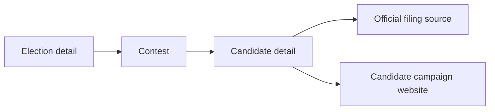
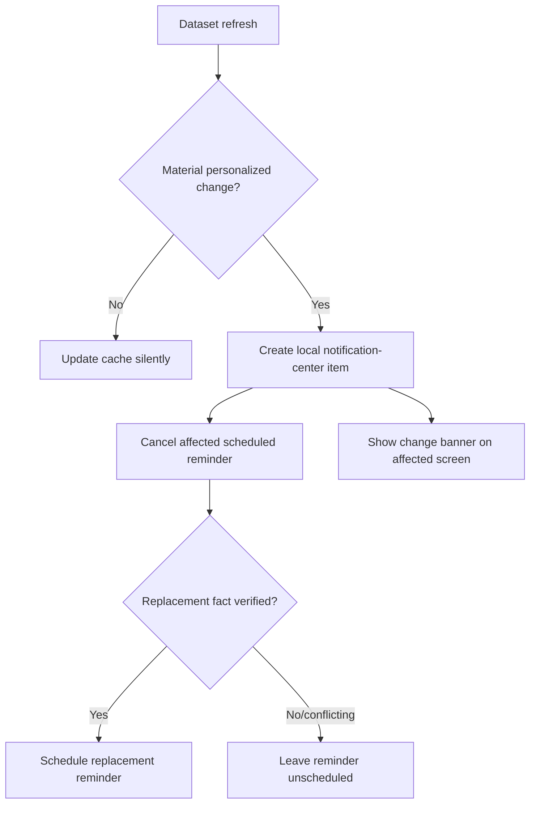
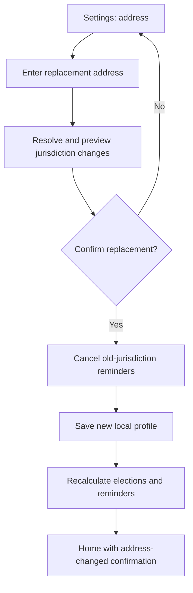

# UI Screen and Flow Specification

Status: implementation planning baseline  
Applies to: nationwide state/federal MVP (50 states plus Washington, DC)  
Related documents: [UI/UX Foundations](ui-ux-foundations.md), [Pre-implementation Decisions](pre-implementation-decisions.md)

## 1. Route map

Route names are conceptual and may be adapted to Expo Router conventions without changing behavior.

```text
/onboarding/language
/onboarding/privacy
/onboarding/address
/onboarding/address-review
/onboarding/eligibility
/onboarding/elections-found
/onboarding/reminders

/(tabs)/home
/(tabs)/elections
/(tabs)/explore
/(tabs)/settings

/elections/:electionId
/elections/:electionId/deadlines/:deadlineId
/elections/:electionId/contests/:contestId
/candidates/:candidateId
/requirements/:requirementId
/sources
/sources/:sourceId
/notifications

/settings/address
/settings/language
/settings/reminders
/settings/privacy
/settings/delete-data
```

Protected routes require a valid local profile. If one is missing or corrupt, route to language selection and preserve only non-personal public dataset cache.

## 2. End-to-end flows

### 2.1 First run



Onboarding has a visible step indicator and Back control. Language can be changed at any step. The address is not persisted as the active profile until the normalized address is confirmed.

### 2.2 Review the next action



Deadline detail always shows the complete date, method qualifier such as `received by`, source, verification date, and applicable jurisdiction.

### 2.3 Review a contest and candidate



The candidate campaign link is visually and programmatically distinguished from an official government source.

### 2.4 Election data changes



The change record includes the prior value, new value, update time, source, and scheduling outcome.

### 2.5 Change address



Failure before confirmation leaves the current profile and reminders unchanged.

### 2.6 Delete local data

Settings → Privacy and local data → Delete local app data → plain-language impact summary → destructive confirmation → cancel all scheduled notifications → delete profile and personalized history → return to language selection.

## 3. Mobile shell

```text
┌─────────────────────────────────┐
│ Page title              Alerts ●│
├─────────────────────────────────┤
│                                 │
│ Scrollable page content         │
│                                 │
│                                 │
├─────────────────────────────────┤
│ Home  Elections  Explore  Settings│
└─────────────────────────────────┘
```

- Respect platform safe areas and system navigation.
- The header action label is exposed to screen readers as `Notifications, 2 unread`, never only as a bell icon.
- The tab bar may use icons, but always includes visible text.
- Offline status appears as an inline banner below the header and does not cover content.

## 4. Screen inventory

| ID | Screen | Entry | Primary outcome | Critical non-happy states |
| --- | --- | --- | --- | --- |
| O1 | Language | First run or Settings | Select English or Spanish | Locale detection unavailable |
| O2 | Address privacy | O1 | Understand and continue | Provider wording not configured |
| O3 | Address entry | O2 or Settings | Submit a residential address | Invalid, ambiguous, PO box, offline, provider error |
| O4 | Address review | Successful O3 | Confirm address and jurisdictions | Missing district, surprising normalization |
| O5 | Eligibility | O4 | Save non-legal attestation | Prefer not to answer |
| O6 | Elections found | O5 | Understand personalized result | No supported election, incomplete contests |
| O7 | Reminder opt-in | O6 | Choose reminder value and optionally grant permission | Denied, provisional, unavailable platform |
| H1 | Home | Completed profile | Take next relevant action | No upcoming election, stale/conflicting data, offline first load |
| E1 | My Elections | Tab | Choose a relevant election | Empty filters, partial data |
| E2 | Election detail | H1/E1/Explore/notification | Understand dates, requirements, contests | Stale, conflict, candidate list incomplete |
| E3 | Deadline detail | H1/E2/notification | Verify and schedule an action | Past deadline, conflict, reminder permission denied |
| E4 | Contest | E2 | Review offices and ordered candidates | Uncontested, withdrawn candidate, no official order |
| C1 | Candidate detail | E4 | Review factual candidate data and sources | Missing party/site, invalid external link |
| R1 | Requirement detail | H1/E2 | Understand a voting requirement | Complex exceptions, stale source |
| X1 | Explore | Tab | Browse nationwide state/federal calendars | No network, cached-only data |
| N1 | Notifications | Header | Review material local updates | Empty, referenced election removed |
| S1 | Settings | Tab | Manage local experience | None |
| S2 | Address settings | S1 | View/change saved address | Re-resolution failure |
| S3 | Reminder settings | S1 | Control categories and offsets | OS permission denied |
| S4 | Language settings | S1 | Change app language | Source available in one language only |
| S5 | Privacy and deletion | S1 | Understand/delete local data | Partial deletion failure |
| P1 | Source detail | Any citation | Inspect provenance | Link unreachable, source replaced |

## 5. Screen specifications

### O1 — Language

**Content order**

1. Product name or temporary wordmark.
2. `Choose your language / Elige tu idioma`.
3. English and Español options, each written in its own language.
4. Continue.

**Behavior**

- Preselect the supported device language when confidently detected; otherwise preselect English.
- The visible text changes immediately when an option is selected.
- Continue remains enabled because a supported value is always selected.
- Changing language later updates app UI and future local notifications. Existing OS-delivered notifications cannot be recalled.

### O2 — Why the address is needed

**Content order**

1. `Find elections for your districts`.
2. Three short explanations: why it is needed, who processes it, where it is stored.
3. Link to Privacy and local data explanation.
4. Continue.

**Rules**

- The resolution provider is named, not described generically as `our partners`.
- Do not show an address field until this disclosure has been shown.
- Provider privacy policy opens as an external link with its organization identified.
- Until `ADDR-01` closes, this screen is blocked from production copy approval.

### O3 — Address entry

```text
Residential address
[Street address                         ]
[Apartment/unit (optional)              ]
[City                    ] [State code]
[ZIP code                              ]

Use the address where you are registered
or intend to register to vote.

[Find my districts]
```

**Rules**

- All 50 states plus Washington, DC are supported. The state is required and is never silently defaulted to Texas or inferred when the provider response is ambiguous.
- Territory, military, overseas, and other unsupported addresses receive an honest scope explanation, not a generic invalid-address error.
- PO boxes are rejected with an explanation that voting districts require a residential address.
- Normalize only after submission; never replace the user's entry without review.
- Submit enters a labeled progress state and prevents duplicate requests without disabling Back.
- Error summary receives focus and links to the specific invalid field on web.
- Offline/provider failure preserves every field and provides Retry.

### O4 — Address review

Show the normalized address followed by each available human-readable jurisdiction. Missing nonessential districts are labeled `Not available` and linked to an explanation. The primary action is `Use this address`; the secondary action is `Edit address`.

If the provider returns multiple plausible addresses, show them as radio choices before this screen. Never resolve ambiguity by picking the first response.

### O5 — Eligibility attestation

Question: `Which best describes you?`

- `I am eligible to vote in U.S. elections.`
- `I am preparing to become eligible.`
- `I prefer not to answer.`

Supporting copy states that the selection does not verify legal eligibility and does not limit access to information. Provide the applicable official state or District of Columbia eligibility link. Do not ask users to interpret felony-status or capacity rules inside onboarding.

### O6 — Elections found

Display the next supported election and a concise jurisdiction summary. If no upcoming election is in the current dataset, say so and explain when data was last checked; never use an empty illustration as the only explanation.

The action `Set up reminders` advances to O7. `Continue without reminders` is equally available but visually secondary.

### O7 — Reminder opt-in

Explain specific value using the voter's data, for example `Get a reminder before the registration deadline on October 5`. Offer category toggles before invoking the OS prompt.

- iOS/Android: request OS permission only after the user selects `Allow reminders`.
- Permission denied: show how to enable later and continue to Home.
- Permission provisional: treat as enabled and explain under Settings if relevant.
- Web: MVP provides the in-app notification center only. Do not show an OS notification permission action until `NOTIF-01` is resolved and implemented.

### H1 — Home

```text
┌─────────────────────────────────┐
│ Home                    Alerts 1│
├─────────────────────────────────┤
│ NEXT ACTION                     │
│ Register to vote                │
│ Due October 5, 2026 · 46 days   │
│ Received/postmarked rules…      │
│ Official state election source  │
│ Verified August 19, 2026        │
│ [View deadline]                 │
├─────────────────────────────────┤
│ NEXT ELECTION                   │
│ State General Election          │
│ November 3, 2026                │
│ U.S. House District … + state…  │
│ [View election]                 │
├─────────────────────────────────┤
│ GET READY                       │
│ □ Check registration            │
│ □ Review ID requirements        │
│ □ Choose how to vote            │
├─────────────────────────────────┤
│ Based on your saved address     │
│ Data checked [date] [Details]   │
└─────────────────────────────────┘
```

**Priority rules**

1. Unread verified change affecting an upcoming action.
2. Registration deadline.
3. Mail-ballot request deadline, only when the user enabled mail-voting reminders; never infer mail-ballot eligibility.
4. Early-voting start/end.
5. Election Day.
6. General preparation checklist.

If the highest-priority fact is conflicting, show the conflict instead of a countdown and do not offer reminder scheduling for it. Completed checklist state is local convenience data and never represents an official completed transaction.

### E1 — My Elections

- Default sort: earliest upcoming election first.
- Segments: Upcoming and Past. Past is not loaded into the initial reading order unless selected.
- Filters: Federal/State and election type. Filter controls announce result count.
- Each card contains election name/type, full date, next action, applicable jurisdiction, completeness state, and reminder state.
- No infinite scroll for the expected MVP volume. Use a finite list with an explicit end.

### E2 — Election detail

**Content order**

1. Election name, type, full date, and jurisdiction.
2. Material alert/change/conflict banner.
3. `What to do next` deadline.
4. All dates and deadlines in chronological order.
5. Voting requirements: registration, in-person ID, early voting, mail voting.
6. Offices and contests grouped Federal then State; grouping is not candidate preference.
7. Source and completeness summary.

Sticky in-page section navigation is permitted on wide screens. On compact screens, use normal document flow; do not hide essential content behind horizontal tabs.

### E3 — Deadline detail

Show:

- localized deadline name;
- exact date, local time when supplied, timezone, and method qualifier (`received by`, `postmarked by`, or `in person by`);
- who it applies to and known exceptions without making a personal eligibility determination;
- a local reminder control;
- source organization, source URL, retrieved date, verified date, and status;
- official next step such as `Open official state voter registration information`.

If the deadline has passed, label it `Passed [date]`; do not leave an enabled reminder action. If a date has changed, show the previous and current values until the notification-center item is read, then retain the change in source detail history.

### E4 — Contest

```text
U.S. Representative, District 7
Federal · Two-year term

Candidates
Listed in official ballot order

1  Candidate name
   Party name · Incumbent
   [View factual profile]

2  Candidate name
   Party name
   [View factual profile]

Order and candidate filing source…
```

- Do not default to a candidate comparison or selection state.
- Candidate rows are not checkboxes and do not mimic a ballot.
- If official ballot order is missing, sort by locale-aware family/display name and label `Official ballot order was not available; shown alphabetically`.
- Withdrawn or disqualified candidates remain only when the official source still includes them or historical context is required; status is explicit and the row is not merely dimmed.
- An uncontested race says `One candidate is listed by the official source`, not `winner`.

### C1 — Candidate detail

MVP sections:

1. Name, party as filed, office, district, and verified incumbency.
2. Official filing information and external identifiers when useful to the voter.
3. Candidate campaign website with a campaign-content interstitial label.
4. Sources and verification dates.

Do not display unsourced biography, ideology, endorsements, polling, generated summaries, fundraising rank, social-media engagement, or an editorial `pros and cons` section. Missing values use `Not provided by the source`, not `N/A` where ambiguity would result.

### R1 — Requirement detail

Use a short factual summary, structured scenarios/exceptions, and an official source. For state voter-ID rules, the UI must preserve alternatives and exceptions rather than reducing a complex rule to `Photo ID required`. Requirements are versioned and show their verification date.

### X1 — Explore

Sections:

- Statewide elections for all supported jurisdictions.
- Federal election calendar.
- U.S. Senate by state.
- U.S. House by state and district.

Explore does not alter the saved jurisdiction. When viewing an out-of-profile item, show `Exploring — not added to My Elections`. Favorites and follow-other-state notifications are out of MVP scope.

### N1 — Notification center

Items include information changes, locally scheduled reminder history when available, newly announced supported elections, and app-level data warnings. Each item contains a timestamp, affected election, source status, read state, and deep link.

- Sort newest first, group by Today/Earlier, and provide `Mark all as read`.
- A notification is read when its detail is opened, not merely when the list appears.
- Deleting an item is out of scope; personalized notification history is removed by Delete local app data.
- Empty copy: `No election updates yet. Important changes to your saved elections will appear here.`

### S1–S5 — Settings

**Settings root order**

1. Saved address and jurisdictions.
2. Language.
3. Reminders.
4. Privacy and local data.
5. Accessibility and help.
6. About, methodology, and source policy.

Address shows a masked summary on the root (`Austin, TX 787…`) and the full locally stored address only on its detail screen. Language changes apply immediately after confirmation. Reminder controls reflect both app preferences and current OS permission state.

Deletion confirmation lists:

- saved address and districts;
- eligibility attestation and preferences;
- notification history and scheduled local notifications;
- personalized election associations.

The operation is idempotent. If notification cancellation fails, deletion completes, the app records no personal data to retry with, and the implementation surfaces a platform-specific warning explaining how to inspect OS-scheduled notifications.

### P1 — Source detail

Display provider, authority classification, exact source URL, retrieved time, verified time, affected facts, language, and change/conflict notes. External-link labels identify the destination. Never show tracking parameters copied from a source URL.

## 6. Shared components

| Component | Required contents | Required states |
| --- | --- | --- |
| `NextActionCard` | Action, exact deadline, relative time, jurisdiction, citation | Verified, changed, stale, conflicting, passed |
| `ElectionCard` | Name/type, date, jurisdiction, next action, completeness | Loading, normal, partial, unavailable |
| `DeadlineRow` | Type, exact date, qualifier, reminder state | Upcoming, today, passed, changed, conflict |
| `CandidateRow` | Order, name, party, incumbency, source access | Normal, missing fields, withdrawn/disqualified |
| `SourceCitation` | Provider, authority, verified date, external action | Verified, stale, replaced, unreachable |
| `DataStatusBanner` | Status label, plain-language impact, next action | Changed, stale, incomplete, conflicting, offline |
| `ReminderControl` | Category, offsets, OS state | On, off, denied, unsupported, unschedulable |
| `EmptyState` | What is absent, why if known, available next action | No elections, no candidates, no updates, filtered empty |
| `ExternalLink` | Destination type and organization | Official government, campaign, third-party provider |

Skeletons match the final content geometry and are not announced repeatedly by screen readers. If loading exceeds 10 seconds, replace indefinite skeletons with an explanatory state and Retry.

## 7. Global failure and edge behavior

### Connectivity

- Cached verified data remains readable offline with `Offline — showing data checked [date]`.
- First load without cached election data provides Retry and applicable official jurisdiction links that may work when connectivity returns.
- A failed background refresh does not erase cached data or reschedule reminders.

### Dataset integrity

- Schema-invalid files are rejected atomically; the previous valid state remains active.
- A missing personalized district is visible as incomplete data and reported to the ingestion diagnostics without the address.
- Removed elections are not deep-link dead ends. Show that the election is no longer in the current dataset, the last known metadata, and a path back to My Elections.

### Time

- Election dates use the election jurisdiction's timezone. Device timezone may be shown only as supplemental context when different.
- Date-only legal deadlines remain date-only; do not invent `11:59 PM`.
- Relative countdowns recompute on foreground and at local midnight without excessive accessibility announcements.
- Daylight-saving changes do not change a date-only deadline or duplicate a scheduled reminder.

### External links

- Validate schemes against an HTTPS allow policy, except explicitly documented government endpoints that have no HTTPS equivalent.
- Confirm before leaving for candidate campaign content; official-government links may open directly after identifying the destination.
- An unreachable link does not change the underlying fact to `unverified`; it is reported separately as a link failure.

## 8. Acceptance scenarios

Implementation is not ready for pilot until all scenarios pass in English and Spanish where applicable:

1. New users can complete onboarding with representative resolvable addresses from every supported state and Washington, DC and reach a correctly personalized Home screen.
2. Invalid, ambiguous, unsupported-territory, military/overseas, PO-box, offline, and provider-error submissions preserve user input and never guess a district.
3. A user who selects `Prefer not to answer` for eligibility receives the same election access.
4. A user denies notifications and still completes onboarding; Settings accurately explains how to enable them later.
5. Web onboarding never requests unsupported native local-notification permission.
6. A verified changed deadline cancels the old reminder, creates the replacement, and explains both values.
7. A conflicting deadline suppresses reminder creation and sends the user to both provenance records.
8. Candidate lists use official ballot order; absent order triggers the labeled alphabetical fallback.
9. Missing candidate fields, an uncontested contest, and a withdrawn candidate do not imply endorsement or completeness.
10. Offline cached screens expose their check date and retain working internal navigation.
11. A changed address is previewed before replacement; a failed replacement leaves the old profile intact.
12. Delete local app data removes the local profile, personalized history, and scheduled reminders and returns to first run.
13. Compact, medium, and wide layouts preserve reading and candidate order at large text and 400% web zoom.
14. Keyboard, VoiceOver, TalkBack, high-contrast, reduced-motion, and screen-reader flows can complete every primary task.
15. Spanish text expansion does not truncate dates, source names, warnings, or actions.
